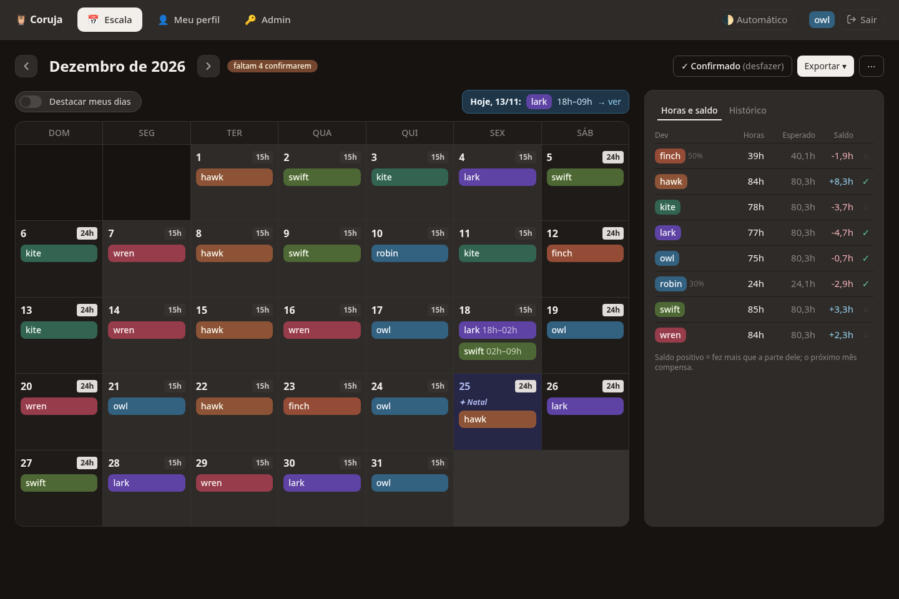
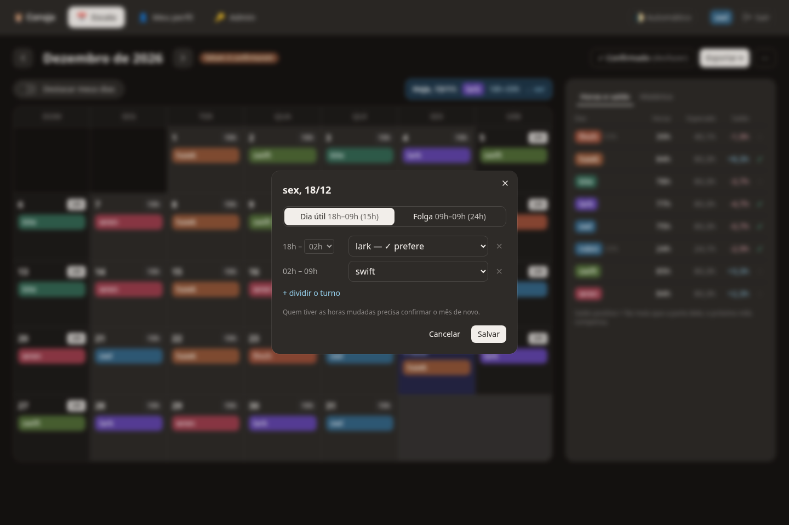
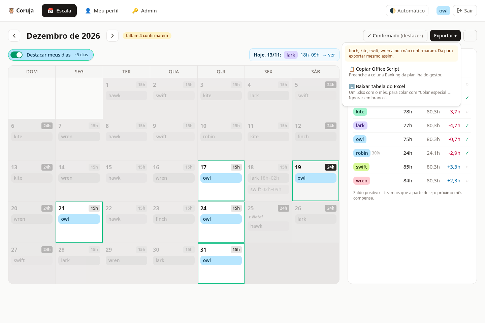
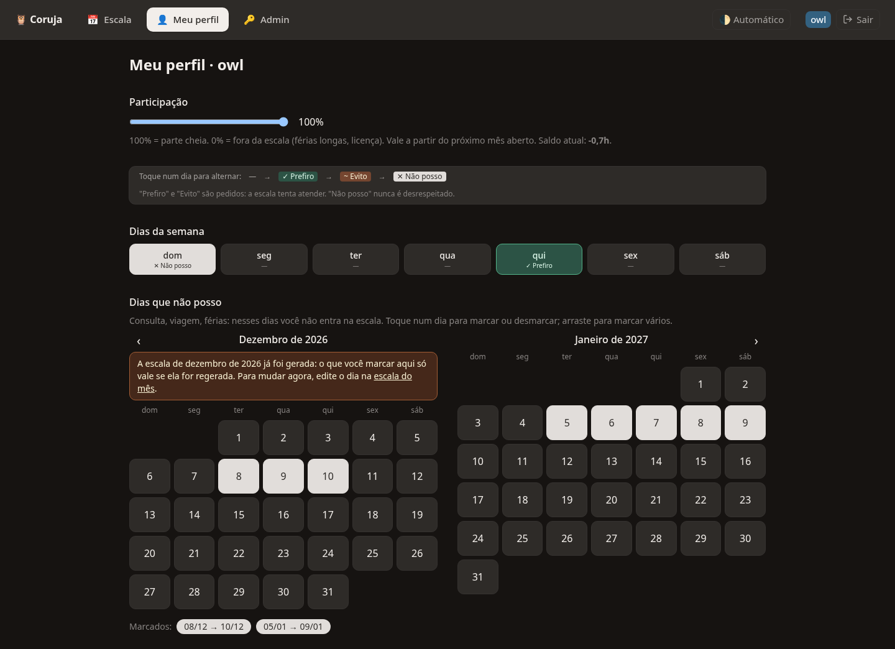
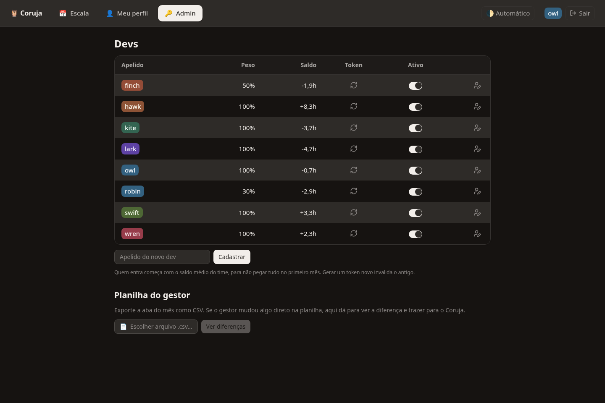
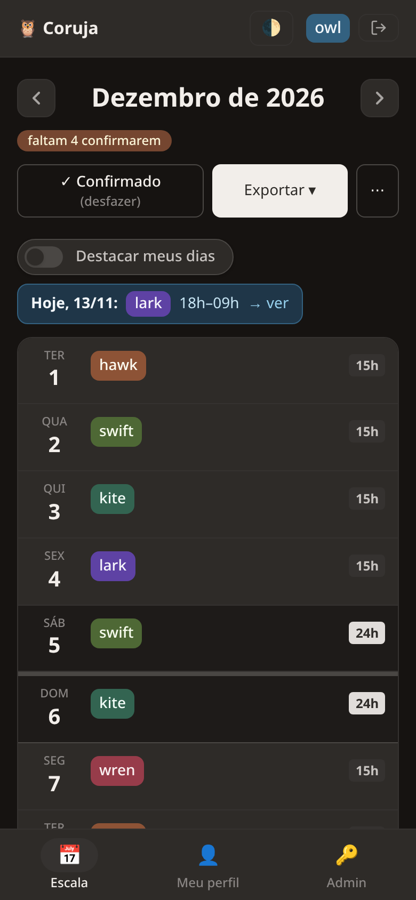

<div align="center">

# 🦉 Coruja

**The dev team's on-call roster, without the monthly meeting.**

Everyone keeps their availability in a profile, Coruja suggests next month's Banking roster balancing
hours across the team, each dev confirms it, and a generated Office Script fills the manager's Excel
sheet.

[](https://github.com/icarosuper/coruja/actions/workflows/ci.yml)




</div>

## How it works

```
 profiles ──► open the month ──► suggested roster ──► everyone confirms ──► Office Script ──► manager's sheet
 (weekdays,    (any dev, when     (balanced by        (or edits a day;      (fills only the
  days off)     the team wants)    hours and weight)   edits are logged)     Banking cells)
```

1. **Each dev keeps a profile**: a participation weight, a rule per weekday ("never on Sundays",
   "Thursday is good") and the specific days they can't take.
2. **Someone opens the next month.** The scheduler suggests one dev per day: "can't" is never broken,
   everything else (hour balance, weekend spread, preferences, back-to-back shifts) is a weighted
   goal.
3. **Each dev confirms or edits.** A day can change hands or be split between two devs; whoever's
   hours change goes back to pending, and every change lands in the month's history.
4. **Anyone exports.** Coruja generates an Office Script that finds the Banking column by date and
   label and fills it — or a `.xlsx` to paste with *Skip blanks*.
5. **Hours carry over.** Whoever took more than their share this month gets less next month.

Infra and Sustentação are out of scope: they keep using the sheet directly.

## Screens

<table>
  <tr>
    <td width="50%"></td>
    <td width="50%"></td>
  </tr>
  <tr>
    <td><b>Edit a day</b> — who takes it, 15h or 24h, split by hour; each dev's preference for that date shows in the list.</td>
    <td><b>Highlight my days and export</b> — light theme; the export menu warns who hasn't confirmed yet.</td>
  </tr>
  <tr>
    <td></td>
    <td></td>
  </tr>
  <tr>
    <td><b>Profile</b> — weight, weekday rules (prefer / avoid / can't) and days off, tapped or dragged on the calendar.</td>
    <td><b>Admin</b> — devs, weights, balances and tokens; compares the manager's sheet (CSV) against the roster.</td>
  </tr>
</table>

<p align="center">
  <br>
  <sub>On phones the calendar becomes a list of days.</sub>
</p>

<sub>Screenshots taken with test data (`scripts/example-team.json`'s nicknames).</sub>

## Shifts

One shift per calendar day, in the Banking column only:

| Day | Starts | Ends | Hours |
|---|---|---|---|
| Workday | 18:00 | 09:00 next day | 15h |
| Weekend or holiday | 09:00 | 09:00 next day | 24h |

Holidays are the city of São Paulo's (national, state and city, movable ones computed from Easter),
and any day can be flipped between 15h and 24h by hand. Hours are counted by calendar hour, like the
sheet's HORAS column: a shift that crosses into the next month splits its hours between both.

## Running locally

Requires [bun](https://bun.sh). Everything runs offline, with a local D1.

```bash
bun install
cp .dev.vars.example .dev.vars   # TEAM_PASSWORD for the admin screen
bun run cf-typegen
bun run db:migrate:local
bun run dev                      # http://localhost:5173
```

Go to **Admin** (link on the sign-in screen), unlock with the team password, add a few devs and sign
in with one of their tokens. To see only the scheduler at work:

```bash
bun run suggest scripts/example-team.json
```

`bun run verify` runs typecheck, lint and tests. Setup, the API by hand and deploy:
[docs/guides/development.md](docs/guides/development.md).

## Stack

Cloudflare Workers (static assets + API in one deploy) · D1 (SQLite) · Drizzle · Hono · Svelte 5 SPA
+ Vite · Tailwind v4 + shadcn-svelte · TypeScript · bun · Biome · Vitest.

The web app is typed straight from the API routes through the Hono client — no hand-written API
types.

## Docs

| | |
|---|---|
| [CONTRIBUTING.md](CONTRIBUTING.md) | how to contribute (branch, PR, commit style) |
| [docs/guides/development.md](docs/guides/development.md) | setup, local run, deploy |
| [docs/agents/architecture.md](docs/agents/architecture.md) | domain model, month lifecycle, invariants |
| [docs/agents/decisions.md](docs/agents/decisions.md) | why things are the way they are |
| [docs/agents/features-index.md](docs/agents/features-index.md) | where each feature, route and screen lives |
| [docs/TODO.md](docs/TODO.md) | what's next |
